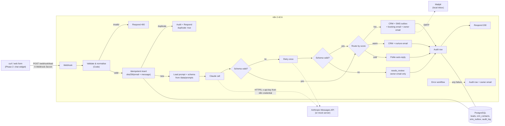

# Lead Qualification Pipeline (n8n + Claude + PostgreSQL)

A self-hosted lead-qualification pipeline. A lead arrives at a webhook; n8n validates it, stores it idempotently, asks Claude to score it **hot / warm / cold** as schema-validated JSON, then routes it: CRM record, emails, SMS, owner notification. Every decision is written to an append-only audit log in PostgreSQL. Everything runs locally with Docker Compose, and a mock Anthropic server lets the whole pipeline run with no API key.

> **Project status (read this first)**
>
> | Part | Status |
> |---|---|
> | Phase 1: webhook intake, Claude qualification, routing, audit log, error workflow | **Built and tested against a mock Anthropic server** |
> | Phase 1 against the **real** Claude API | **Not yet run.** No API key has been used so far. |
> | Phase 2: chat widget + chat workflow | Not built |
> | Evaluation (60 synthetic leads, accuracy / confusion matrix / hot recall) | Not run. **No accuracy numbers exist yet.** |
> | Screenshots and screen recording | Not captured yet (see [Screenshots](#screenshots-and-recording)) |
> | GitHub Actions CI and gitleaks | Not written yet |

## Architecture



## Quick start

Requirements: Docker with Compose v2, `curl`. Node.js is only needed for `scripts/export.sh`.

```bash
cp .env.example .env
```

Pick **one** of the two ways to run the model:

**A. Real Claude API.** Edit `.env`:

```
ANTHROPIC_API_KEY=sk-ant-...        # your key
ANTHROPIC_BASE_URL=https://api.anthropic.com
CLAUDE_MODEL=claude-haiku-5-5       # check the models page before changing
```
```bash
docker compose up -d
```

**B. Mock Anthropic server (no key needed).** Edit `.env`:

```
ANTHROPIC_API_KEY=mock-key          # any non-empty value
ANTHROPIC_BASE_URL=http://mock-anthropic:8080
```
```bash
docker compose --profile mock up -d
```

The mock scores leads with a crude keyword heuristic. It exists to exercise the pipeline, so **never treat its output as evidence of model quality**.

On a clean machine, startup took about 26 s in my test. `docker compose up` also runs a one-shot `n8n-init` service that renders credentials from `.env`, imports `workflows/*.json` and publishes them. It is safe to re-run.

### Try it

| What | URL |
|---|---|
| Webhook | `http://localhost:5679/webhook/lead` |
| n8n editor | http://localhost:5679 (first visit asks you to create an owner account; the webhooks work without it) |
| Mailpit inbox | http://localhost:8025 |
| PostgreSQL | `localhost:5442` (user/password from `.env`) |

```bash
SECRET=change-me-webhook-secret   # LEAD_WEBHOOK_SECRET in .env
curl -s -X POST http://localhost:5679/webhook/lead \
  -H "X-Webhook-Secret: $SECRET" -H 'content-type: application/json' \
  -d '{"name":"Dana Whitfield","email":"dana@bigco.example","phone":"+14155550134",
       "message":"We have budget approved and need to go live next week. Can we book a call and get a quote ASAP?",
       "source":"web_form"}'
```

Example response (from the mock run):

```json
{"ok":true,"duplicate":false,"lead_id":1,"route":"hot","score":"hot","action_taken":"crm_contact_created; booking_email_sent; sms_queued_in_outbox; owner_notified"}
```

Look at the results:

```bash
docker compose exec postgres psql -U leads_app -d leads -c "select id,name,status,score from leads"
docker compose exec postgres psql -U leads_app -d leads -c "select lead_id,event,score,action_taken from audit_log order by id"
```
Emails are in Mailpit (http://localhost:8025).

### Request and response contract

`POST /webhook/lead`, header `X-Webhook-Secret`, JSON body:

| Field | Rule |
|---|---|
| `name` | required, 1-200 chars |
| `email` | required, valid address, max 254 (lower-cased) |
| `phone` | optional, 7-15 digits, optional leading `+` (spaces, dashes and brackets are stripped) |
| `message` | required, 1-5000 chars |
| `source` | required, letters/digits/`-`/`_`, max 40 |

| Outcome | HTTP | Body |
|---|---|---|
| Missing or wrong secret | 403 | n8n's auth error |
| Invalid body | 400 | `{"ok":false,"error":"validation_failed","details":[...]}` |
| New lead | 200 | `{"ok":true,"duplicate":false,"lead_id","route","score","action_taken"}`; `route` is `hot`, `warm`, `cold` or `needs_review` (`score` is `null` for `needs_review`) |
| Duplicate | 200 | `{"ok":true,"duplicate":true,"lead_id"}` |
| Unexpected workflow failure | 500 | `{"message":"Error in workflow"}`; the error workflow has logged and emailed the owner |

## How routing works

| Score | Actions |
|---|---|
| **hot** | Create CRM record, email the lead a booking link, queue an SMS (if a phone was given), email the owner |
| **warm** | Create CRM record, send a nurture email |
| **cold** | Log it, send a polite auto-reply |
| **needs_review** | Log it, email the owner. **No automated action** towards the lead. Used when the model call fails or its output is invalid after one retry. |

Qualification details:

- **Prompt** lives in `prompts/qualify.v1.md`, not in the workflow. The version is selected by `QUALIFY_PROMPT_VERSION`.
- **Output contract** is `prompts/qualify.v1.schema.json`: `score`, `intent`, `urgency`, `budget_signal`, `summary`, `suggested_next_step`, with enums and length limits and no extra keys. A Code node validates the model's reply against this schema (the node implements the subset of JSON Schema the file uses).
- **One retry:** on invalid output the model is called a second time, shown its previous reply and our validation errors. Still invalid means `needs_review`.
- **Model ID** comes from `CLAUDE_MODEL`. It is not hard-coded in any workflow.
- **Prompt injection:** lead text is passed inside `<lead>` tags and the prompt tells the model to treat it as data. This is a mitigation, not a guarantee. A bad score only ever causes a wrong route, and the worst case for a manipulated "hot" is an extra email and CRM row.
- **Untrusted text in email:** every lead- or model-supplied value is HTML-escaped, and subject lines have control characters stripped. Verified with a `<script>` / `` / CRLF payload.

## What is a stand-in

Nothing here is connected to a real third-party system.

| Piece | In this repo | In production you would use |
|---|---|---|
| CRM | A `crm_contacts` table in PostgreSQL | HubSpot, GoHighLevel, etc. |
| SMS | Rows written to `sms_outbox` with `status = 'queued'`. **No SMS is sent.** | Twilio (or similar) |
| Email | Mailpit, a local SMTP inbox. Nothing leaves your machine. | A real SMTP / transactional provider |
| Booking link | `BOOKING_LINK_URL`, default `https://example.com/book-a-call` | Calendly, Cal.com, etc. |
| Company / sender | Fictional "Acme", `sales@acme.test` | Your business |

## What this does and does not guarantee

- **Idempotency:** a lead is keyed on `sha256(lower(email) + "\n" + message)` with a `UNIQUE` constraint, so concurrent duplicates cannot both insert. The same person sending a *different* message is a new lead. A duplicate burns a sequence number, so `lead_id`s can have gaps.
- **Partial failure is not retried.** The lead row is stored before the actions run. If the workflow crashes midway (for example SMTP is down after the CRM insert), the owner is alerted and the failure is audited, but resubmitting the same lead is treated as a duplicate and is **not** reprocessed. I reproduced this with a deliberately broken `BOOKING_LINK_URL`. A production version would need a status-based retry.
- **Audit log:** `UPDATE`, `DELETE` and `TRUNCATE` on `audit_log` are rejected by Postgres triggers, and `tests/audit_log_immutable.sql` proves it. This is not tamper-proof: the table owner or a superuser can drop the trigger. A stronger setup runs the app as a role that owns nothing and cannot alter triggers.
- **Webhook auth** is a single shared secret in a header. It authenticates callers but gives no per-client identity, rate limiting or replay protection.
- **Secrets:** the Anthropic API key is read only by the one-shot `n8n-init` container, which stores it as an encrypted n8n credential. The long-running `n8n` container's environment does not contain it. Because n8n 2.x blocks `$env` in Code nodes by default, I enabled it (`N8N_BLOCK_ENV_ACCESS_IN_NODE=false`) for non-secret settings only (model ID, booking link, owner email). Note that the n8n container does hold the DB password and encryption key, so anyone who can edit workflows in the editor can read them. Treat editor access as privileged.
- **The model call is untested against the real API** so far (see status above). Request shape follows the current Messages API docs; I did not send `temperature` or a `thinking` parameter, and responses are read from `text` content blocks only.

## Testing

```bash
bash scripts/test-audit.sh      # audit_log rejects UPDATE/DELETE/TRUNCATE (5 assertions, rolls back, leaves no rows)
```

Failure modes can be triggered deterministically with the mock by putting a marker in the lead's `message`:

| Marker | Effect | Expected result |
|---|---|---|
| `[mock:malformed-once]` | First reply is prose, retry is valid | Normal route, proves the retry |
| `[mock:malformed]` | Every reply is prose | `needs_review` |
| `[mock:wrong-enum]` | `score` is `"lukewarm"` | `needs_review` (schema rejects it) |

An API key of `invalid` makes the mock return 401 like the real API, which lands in `needs_review`.

What I verified in this repo so far, all against the mock: the 403/400 paths, hot/warm/cold routing with the expected emails, CRM rows, SMS outbox row and audit rows, duplicate handling, retry, `needs_review` for malformed output / wrong enum / bad key, the error workflow, email escaping, a clean boot from empty volumes, and a stable export → import → export round trip.

## Working with the workflows

Workflows are stored as `workflows/*.json` (normalised: no timestamps or version ids, so diffs show real changes).

```bash
bash scripts/export.sh      # running n8n  -> workflows/*.json
bash scripts/import.sh      # workflows/*.json -> running n8n (re-publishes, restarts n8n)
```

Set `USE_MOCK=1` when calling `import.sh` if you run with the mock profile. `docker compose up -d` already imports on start, so you only need `import.sh` after editing workflow files while the stack is up.

Two workflows:

- **Lead Intake** (`lead-intake`): everything in the diagram above.
- **Lead Intake - Error Handler** (`lead-error-handler`): set as the intake workflow's error workflow. Writes a `workflow_error` audit row and emails the owner.

## Repository layout

```
docker-compose.yml     n8n, PostgreSQL, Mailpit, n8n-init (one-shot), mock-anthropic (profile "mock")
.env.example           every setting, documented
workflows/             exported n8n workflows
prompts/               qualify.v1.md + qualify.v1.schema.json (mounted read-only into n8n)
sql/                   schema + audit-log triggers (run on first DB boot)
n8n/                   credential template filled from .env by n8n-init
scripts/               init-n8n.sh, export.sh, import.sh, test-audit.sh, helpers
mock/                  mock Anthropic Messages API (stdlib Python)
tests/                 SQL test for audit-log immutability
```

Pinned images: `n8nio/n8n:2.42.6`, `postgres:17.9-alpine`, `axllent/mailpit:v1.31.4`, `python:3.13.16-alpine`.

Host ports: n8n **5679**, Mailpit 8025 (UI) / 1025 (SMTP), PostgreSQL **5442**, mock 8081. They are non-default on purpose so the stack can run next to another n8n or Postgres. Change them in `.env` (`N8N_HOST_PORT`, `POSTGRES_PORT`).

## Screenshots and recording

Not captured yet. These will be added from real runs, not mock-ups:

- [ ] n8n canvas of the Lead Intake workflow
- [ ] A Mailpit email (hot lead)
- [ ] PostgreSQL rows (`leads`, `crm_contacts`, `audit_log`)
- [ ] 60-90 s recording of a lead going end to end

## Evaluation

Not run yet. Planned protocol:

- `eval/generate.py` creates 60 **synthetic**, labelled leads (hot / warm / cold, including messy and ambiguous ones), split into 30 dev (used to tune the prompt) and 30 gate (held out, not looked at until the final run).
- `eval/run.py` sends each lead through the real webhook and compares Claude's score to the label.
- Report: accuracy, confusion matrix, recall on `hot`. The data is synthetic, and results say nothing about real-world performance.
- The **first run is kept on record even if it is bad**, with what failed and what changed.

Results, including that first run, will go here once they exist. This section intentionally contains no numbers.

## License

No license has been chosen yet.
